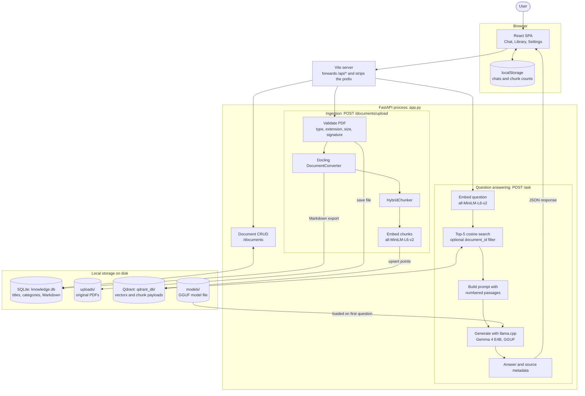

<div align="center">

# Knowledge AI

### A local-first, full-stack document intelligence platform

*Upload PDFs, build a searchable knowledge base, and ask questions that are answered from your own documents, with the retrieved passages cited for every answer.*


</div>

---

Language models answer confidently about documents they have never seen. Knowledge AI closes that gap with retrieval-augmented generation (RAG): it converts your PDFs into structured text, indexes them as vectors, retrieves the passages most relevant to each question, and asks a language model to answer **only from that evidence**, citing the passages it used.

The whole pipeline runs on your machine. Documents are parsed with Docling, embedded with a local Sentence Transformers model, stored in an embedded Qdrant database, and answered by Gemma running inside the backend through llama.cpp. Nothing is sent to a hosted AI API.

> [!NOTE]
> **You are reading the `nolmstudio` branch.** Here the backend runs the language model itself, from a model file you download once, so LM Studio is not needed. The `main` branch instead sends questions to a model served by LM Studio. See [Branches](#branches).

This is a learning and portfolio project built to show how the parts of a RAG system fit together end to end. It is not hardened for production; the [limitations](#limitations) are documented as carefully as the features.

## Table of contents

- [Highlights](#highlights)
- [Product preview](#product-preview)
- [Features](#features)
- [Architecture](#architecture)
- [Tech stack](#tech-stack)
- [Branches](#branches)
- [Getting started](#getting-started)
- [Local language model](#local-language-model)
- [Configuration](#configuration)
- [API reference](#api-reference)
- [How RAG works here](#how-rag-works-here)
- [Testing and evaluation](#testing-and-evaluation)
- [Project structure](#project-structure)
- [Limitations](#limitations)
- [Roadmap](#roadmap)
- [Contributing](#contributing)
- [License](#license)

## Highlights

- **A complete RAG loop, not just a chat box.** Ingestion, structure-aware chunking, embedding, vector search, grounded generation, and source attribution are all implemented and visible in the code.
- **Citations you can check.** The model is told to cite `[Source N]`, and the API returns the matching source list in the same order, so the UI can link every marker to the passage's file, section headings, and similarity score.
- **Defensive ingestion.** Uploads are validated four ways, streamed to disk with a size cap, and rolled back from SQLite and disk if conversion or indexing fails.
- **Tested API contract.** 76 backend tests cover CRUD, upload validation, the question-answering endpoint, and the local model adapter, with the model and vector database replaced by fakes so the suite needs no model file or external services.
- **Measured retrieval.** A small evaluation script reports Recall@5, Precision@5, and reciprocal rank against a labelled question set, and states its own limits.

## Product preview

### The workflow

1. **Upload a PDF** from the Documents page (drag and drop, several files at once, 40 MB each at most).
2. **Validation and conversion.** The backend checks the file and Docling converts it into a structured document, which is also exported as Markdown.
3. **Chunking and embedding.** Docling's `HybridChunker` splits the document along its structure, and each chunk becomes a 384-dimensional vector.
4. **Indexing.** Vectors and chunk text are stored in a persistent local Qdrant collection.
5. **Ask a question** in the chat, across all indexed documents or scoped to one.
6. **Retrieval.** The question is embedded and the five most similar passages are fetched.
7. **Grounded answer.** Gemma answers from those passages and cites them. The UI shows each source's filename, section headings, and similarity score.

### Screenshots

> [!NOTE]
> No screenshots are committed to the repository yet. The four below would show the product best. A `docs/screenshots/` folder is a suggested location; it does not exist yet.

| Suggested capture | What it should show |
|---|---|
| Chat with a cited answer | An answer containing citation markers, with the source list expanded to show headings and similarity scores |
| Document library | Uploaded PDFs, the search box, category filters, and an upload in progress |
| Document detail | Extracted Markdown for one PDF, its metadata, and the "Ask about this document" action |
| Settings | Backend connection status and the pipeline configuration summary |

## Features

### Ingestion

| Feature | What it does | Why it matters |
|---|---|---|
| PDF upload and validation | Checks the content type, the `.pdf` extension, a 40 MB limit while streaming, and the `%PDF-` file signature | Rejects wrong or oversized files before any expensive processing starts |
| Docling conversion | Converts the PDF into a structured document and exports Markdown for storage and display | Keeps headings and layout that naive text extraction loses |
| Structure-aware chunking | `HybridChunker` splits along document structure and sizes chunks with the embedding model's own tokenizer | Chunks stay coherent and fit the model that embeds them |
| Local embeddings | `all-MiniLM-L6-v2` produces normalized 384-dimensional vectors | Small enough to run on a CPU; no external embedding API |
| Persistent vector index | Chunks are upserted into an on-disk Qdrant collection using cosine distance | The index survives restarts without running a separate database server |
| Failure rollback | If conversion or indexing fails, the SQLite row, the saved file, and any partially indexed vectors are removed | A failed upload does not leave half-ingested data behind |

### Question answering

| Feature | What it does | Why it matters |
|---|---|---|
| Semantic retrieval | Embeds the question and returns the top 5 passages by cosine similarity | Finds passages by meaning rather than exact keywords |
| Document-scoped questions | An optional `document_id` filters retrieval to a single PDF | Avoids cross-document noise when you know where the answer lives |
| Grounded generation | The prompt supplies numbered passages and instructs the model to answer from them, admit when they are insufficient, and treat them as evidence rather than instructions | Reduces hallucination and blunts prompt injection from document text |
| Source citations | Every answer returns the filename, headings, chunk ID, and similarity score of each retrieved passage | Answers can be traced back to where they came from |

### Frontend

| Feature | What it does |
|---|---|
| Chat interface | Markdown answers, clickable citation markers, a per-answer source list, copy, retry, and stop |
| Scope picker | Ask across all indexed documents or limit the next question to one |
| Document library | Server-side search over titles and content, category filters, and a sequential upload queue with progress |
| Document detail and editing | View extracted content and metadata; edit title, category, and content; delete with confirmation |
| Local chat history | Up to 30 conversations saved in the browser's `localStorage` |
| Backend status | A live indicator that polls the API, plus a Settings page summarizing the pipeline configuration |

## Architecture



**In plain English:**

- **Frontend.** A React single-page app. The browser only ever talks to its own origin under `/api`; the Vite server forwards those requests to FastAPI and removes the prefix. This is required because the backend sends no CORS headers.
- **API.** A single FastAPI application (`app.py`) exposes document CRUD, PDF upload, and question answering. The RAG service is created lazily on the first upload or question and then reused, so CRUD-only use never loads the embedding model. The language model is loaded later still, on the first question, so uploading never loads it.
- **Ingestion.** An upload is validated, saved under a random filename, converted by Docling, stored in SQLite as Markdown, then chunked, embedded, and upserted into Qdrant. Chunking runs on Docling's structured document, not on the flattened Markdown.
- **Storage.** Three local stores with different jobs: SQLite holds document records and extracted text, `uploads/` holds the original PDFs, and Qdrant holds vectors plus each chunk's text and metadata. The language model's weights are a single file in `models/`.
- **Retrieval and generation.** A question is embedded with the same model used for the chunks, Qdrant returns the nearest passages, and those passages are given to Gemma, which llama.cpp runs inside the backend process (`app_services/llm.py`). The model answers one question at a time.
- **What runs where.** FastAPI, the embedding model, the language model, Docling, SQLite, and Qdrant (embedded mode) all run inside the backend process. Only the **Vite server** is started separately.

## Tech stack

| Layer | Technology | Responsibility |
|---|---|---|
| Frontend | React 19, TypeScript, React Router | Single-page interface for chat, library, and settings |
| Frontend tooling | Vite 8, Tailwind CSS 4, ESLint | Dev server, API proxy, styling, linting |
| Answer rendering | react-markdown, remark-gfm | Markdown answers with linked citation markers |
| API | FastAPI, Pydantic, Uvicorn | HTTP endpoints, request validation, OpenAPI docs |
| PDF processing | Docling `DocumentConverter` | PDF to structured document and Markdown |
| Chunking | Docling `HybridChunker` | Structure-aware, tokenizer-aligned passage segmentation |
| Embeddings | Sentence Transformers `all-MiniLM-L6-v2` | 384-dimensional normalized vectors for chunks and questions |
| Vector database | Qdrant (embedded, on-disk) | Cosine similarity search with payload filtering |
| Metadata store | SQLite (standard library `sqlite3`) | Document records and extracted Markdown |
| LLM | Gemma 4 E4B (GGUF, 4-bit) run in process with `llama-cpp-python` | Grounded answer generation |
| Model download | `huggingface-hub` | Fetches the model file on request |
| Testing | pytest, FastAPI `TestClient` | API tests with faked RAG and Docling |
| Packaging | uv (backend), npm (frontend) | Dependency management and virtual environment |

## Branches

| Branch | How the language model runs | What you install for it |
|---|---|---|
| `main` | LM Studio serves Gemma over an OpenAI-compatible API on `localhost:1234`, and the backend calls it | LM Studio, with the model loaded and its server started |
| `nolmstudio` (this one) | The backend loads a GGUF model file and runs it with llama.cpp | Nothing beyond `uv sync` and one model download |

Everything else is the same on both branches: the API, the frontend, PDF ingestion, the embedding model, the Qdrant index, the prompt, and the citation format. Data created on one branch (`knowledge.db`, `uploads/`, `qdrant_db/`) works on the other.

## Getting started

### Prerequisites

| Requirement | Notes |
|---|---|
| [uv](https://docs.astral.sh/uv/) | Manages Python and the virtual environment. The project requires Python 3.13.15 or newer (pinned in `.python-version`); uv installs it if needed. |
| Node.js 20.19+ and npm | For the frontend. Developed with Node 24. |
| About 6 GB of free disk and 16 GB of RAM | For the language model. See [Hardware](#hardware). Needed only for asking questions. |
| Internet access on first run | Docling and Sentence Transformers download their model weights the first time they are used. |

### 1. Clone and install the backend

```bash
git clone --branch nolmstudio https://github.com/YoussefIEissa/ai-knowledge-base.git
cd ai-knowledge-base
uv sync
```

`uv sync` installs a prebuilt CPU build of llama.cpp for Linux (x86-64 and ARM64), Windows (x86-64), and macOS on Apple Silicon, so no compiler is needed. It does **not** download the language model; that is step 3. For other platforms, or to use a GPU, see [GPU acceleration](#gpu-acceleration-optional).

### 2. Create the Qdrant collection (first run only)

The backend expects the `qdrant_db/` directory and its `knowledge_base` collection to exist already; it does not create them on startup. Local data is git-ignored, so a fresh clone has neither. Create them once from the project root:

```bash
uv run python - <<'EOF'
from qdrant_client import QdrantClient, models

client = QdrantClient(path="qdrant_db")
if not client.collection_exists("knowledge_base"):
    client.create_collection(
        "knowledge_base",
        vectors_config=models.VectorParams(size=384, distance=models.Distance.COSINE),
    )
client.close()
EOF
```

Without this step, uploads and questions return `503` with "The RAG service is unavailable."

### 3. Download the language model

```bash
uv run python scripts/download_model.py
```

The command shows what it will download (one 5.15 GB file) and where it will be stored (`models/`, which is git-ignored), then asks for confirmation. Add `--yes` to skip the question. If the download is interrupted, run the same command again and it resumes. When it finishes, the file is checked against its published size and SHA-256 hash.

No account, token, or licence approval is needed: the model repository is public and not gated.

Optionally, check that the model loads and answers before starting the server:

```bash
uv run python scripts/llm_smoke_test.py
```

You can skip this step if you only want to upload and browse documents. Questions will return `503` until the model file exists; the server does not need a restart once it does.

### 4. Start the backend

```bash
uv run uvicorn app:app --reload
```

The API listens on `http://127.0.0.1:8000`. The SQLite database (`knowledge.db`) and its table are created automatically on startup.

### 5. Start the frontend

In a second terminal:

```bash
cd frontend
npm install
npm run dev
```

### 6. Open the app

| What | URL |
|---|---|
| Application | <http://localhost:5173> |
| Interactive API docs (Swagger UI) | <http://127.0.0.1:8000/docs> |
| Alternative API docs (ReDoc) | <http://127.0.0.1:8000/redoc> |

Upload a PDF on the Documents page, then ask a question in the chat. The first upload and the first question are slower than later ones because the models are loaded on first use: the first question reads the 5 GB model file into memory.

<details>
<summary><strong>Troubleshooting</strong></summary>

| Symptom | Likely cause | Fix |
|---|---|---|
| `503` "The RAG service is unavailable." | `qdrant_db/` or the collection is missing, or another process has the Qdrant directory open | Run step 2; stop other scripts using `qdrant_db/` |
| `502` "Unable to generate an answer right now." | Retrieval or generation failed | Read the backend log. See [Troubleshooting the model](#troubleshooting-the-model) |
| `503` "The language model is not available." | The model file is missing or an `LLM_*` setting is invalid | Run step 3. The backend log names the exact problem |
| `504` "The language model took too long to answer." | Generation passed `LLM_TIMEOUT_SECONDS`, or earlier questions were still being answered | See [Troubleshooting the model](#troubleshooting-the-model) |
| "Backend unreachable" in the UI | FastAPI is not running or is on another address | Start it, or set `KNOWLEDGE_API_URL` (see [Configuration](#configuration)) |
| "Backend not responding" during an upload | The backend is busy converting a PDF | Wait for the upload to finish |
| `415` or `400` on upload | The file is not a real PDF | Upload a `.pdf` file of 40 MB or less |

</details>

## Local language model

### The model

| | |
|---|---|
| Model | Gemma 4 E4B, instruction-tuned, quantization-aware-trained 4-bit (`Q4_0`) |
| Source | [`google/gemma-4-E4B-it-qat-q4_0-gguf`](https://huggingface.co/google/gemma-4-E4B-it-qat-q4_0-gguf) on Hugging Face, published by Google |
| File | `gemma-4-E4B_q4_0-it.gguf`, 5.15 GB |
| License | Apache-2.0 |
| Access | Public, not gated. No Hugging Face account or token is needed |
| Runtime | [`llama-cpp-python`](https://github.com/abetlen/llama-cpp-python) 0.3.36, the Python binding for llama.cpp |

This is the same Gemma model the `main` branch uses through LM Studio, in the GGUF format llama.cpp reads. The download script pins the exact repository revision and verifies the file's SHA-256 hash.

The repository also contains a vision projector file (`mmproj`). This project sends text only, so it is not downloaded.

### Two different models

The project uses two models, and this branch changes only one of them.

| | Embedding model | Language model |
|---|---|---|
| Job | Turns chunks and questions into vectors for search | Writes the answer from the retrieved passages |
| Model | `sentence-transformers/all-MiniLM-L6-v2` | Gemma 4 E4B (GGUF) |
| Size | About 90 MB | 5.15 GB |
| How it arrives | Downloaded automatically by Sentence Transformers on first use | Only by running `scripts/download_model.py` |
| Stored in | The Hugging Face cache in your home directory | `models/` in the project |
| Changed by this branch | No | Yes |

The vectors in Qdrant come from the embedding model. Because that model is unchanged, an existing `qdrant_db/` keeps working and nothing needs re-indexing.

### Hardware

The model runs on a CPU. A GPU is optional and makes answers arrive faster.

| | CPU only (default) | With a supported GPU |
|---|---|---|
| Disk | 5.15 GB for the model file | The same, plus about 0.8 GB for the GPU build of llama.cpp |
| System memory used by the backend | About 10 GB | About 5 GB |
| GPU memory | None | About 4.5 GB |
| Suggested machine | 16 GB of RAM | 16 GB of RAM and a GPU with 6 GB or more |

The memory figures are what the backend process used on the test machine with the default settings, with both the language model and the embedding model loaded. They are measurements from one machine, not guarantees. A larger `LLM_CONTEXT_LENGTH` uses more.

**What to expect for speed.** On the test machine (AMD Ryzen 9 9900X with 12 cores, NVIDIA RTX 5070 Ti, Linux under WSL2), the same questions against the same five retrieved passages took:

| | CPU only | GPU |
|---|---|---|
| Short answers (400 to 800 characters) | 8 to 12 s | 1 to 2 s |
| A long answer (about 2,500 characters) | About 50 s | About 6 s |
| First question after the backend starts, including loading both models | About 15 s | About 6 s |

A laptop CPU with fewer cores will be slower than this, possibly several times slower, and long answers may then pass the 120-second default time limit; see [Troubleshooting the model](#troubleshooting-the-model). A machine with less than about 10 GB of free memory may not be able to load the model at all. If yours cannot, try a smaller GGUF model (see [Using a different model](#using-a-different-model)).

### GPU acceleration (optional)

Skip this unless CPU answers are too slow. `uv sync` always installs the CPU build, and the application works without a GPU.

GPU support comes from a different build of the same `llama-cpp-python` version. The project publishes prebuilt ones:

| Hardware | Platform | Index name |
|---|---|---|
| NVIDIA, CUDA 13 | Linux x86-64, Windows | `cu130` |
| NVIDIA, CUDA 12 | Linux x86-64, Windows | `cu124` or `cu125` |
| Any GPU with Vulkan drivers | Linux x86-64, Windows | `vulkan` |
| Apple Silicon | macOS | `metal` |

1. Install the build for your hardware over the CPU one, replacing `cu130` with the index name from the table:

   ```bash
   uv pip install --reinstall-package llama-cpp-python "llama-cpp-python==0.3.36" \
     --extra-index-url https://abetlen.github.io/llama-cpp-python/whl/cu130
   ```

   The NVIDIA builds are large (about 780 MB for `cu130`). They need a working NVIDIA driver; pick the CUDA version your driver supports, which `nvidia-smi` shows.

2. Check that it works before relying on it:

   ```bash
   uv run python scripts/llm_smoke_test.py
   ```

   The log must contain `GPU offload supported by this build: True`, and the test must end with `OK`. Having an NVIDIA GPU does not by itself mean this will succeed: the driver, the CUDA version, and free GPU memory all have to match.

3. Start the backend as usual. `LLM_GPU_LAYERS` defaults to `-1`, which puts the whole model on the GPU. If the GPU has too little free memory, set a smaller number of layers, or `0` for none.

**If it does not work**, or to go back to the CPU at any time:

```bash
uv sync --reinstall-package llama-cpp-python
```

This restores the CPU build recorded in `uv.lock`. The GPU build is a local change to your virtual environment only: it is not recorded in `pyproject.toml` or `uv.lock`, a later `uv sync --reinstall` or a new virtual environment returns to the CPU build, and step 1 must then be repeated.

Only the `cu130` build on Linux was tested for this branch, on an RTX 5070 Ti. The other builds are published by the same project but were not tried here.

The embedding model is separate: Sentence Transformers uses a GPU through PyTorch when one is available, independently of this setting.

### Using a different model

Any chat model in GGUF format that llama.cpp supports can be used. Put the file anywhere and set `LLM_MODEL_PATH` to it (see [Configuration](#configuration)). The model must have a chat template that accepts a system message. Answer quality, speed, and memory use will differ, and the download script and its checksum apply only to the default model.

### Troubleshooting the model

The API returns short, fixed error messages. The backend log has the specific cause.

| Symptom | Likely cause | Fix |
|---|---|---|
| `503`, log says "Model file not found" | The model was not downloaded, or `LLM_MODEL_PATH` points elsewhere | Run `uv run python scripts/download_model.py`, or correct the path |
| `503`, log names an `LLM_*` setting | The setting has an invalid value | Fix or unset it. Valid ranges are in [Configuration](#configuration) |
| `503`, log says "Could not load" | The file is incomplete or corrupt, is not a GGUF chat model, or there is not enough free memory | Run the download script again; it verifies the file. Close other programs, or lower `LLM_CONTEXT_LENGTH` |
| `504` on a long question | Generation is slower than the time limit, usually on a CPU | Raise `LLM_TIMEOUT_SECONDS`, lower `LLM_MAX_TOKENS`, or use a GPU |
| `504` when several questions are asked at once | Questions are answered one at a time and this one waited too long | Ask again when the earlier answers have arrived |
| `502`, log says the prompt does not fit the context window | The question plus five passages is longer than `LLM_CONTEXT_LENGTH` | Raise `LLM_CONTEXT_LENGTH` |
| Answers stop mid-sentence | The answer reached `LLM_MAX_TOKENS` (the log has a warning) | Raise `LLM_MAX_TOKENS` |
| The backend process is killed during the first question | The machine ran out of memory while loading the model | See [Hardware](#hardware) |
| `uv sync` tries to compile llama-cpp-python, or finds no matching wheel | There is no prebuilt CPU wheel for your platform, for example an Intel Mac | Install a C++ compiler and CMake, remove the `[tool.uv.sources]` and `[[tool.uv.index]]` entries for `llama-cpp-python` from `pyproject.toml`, and run `uv sync` to build from source |

## Configuration

The backend needs no `.env` file or API keys. The language model is configured with optional environment variables; every one has a default, so nothing needs to be set for a standard setup.

| Variable | Default | Valid values | Purpose |
|---|---|---|---|
| `LLM_MODEL_PATH` | `models/gemma-4-E4B_q4_0-it.gguf` | Path to a `.gguf` file | The model file. A relative path is resolved from the project root |
| `LLM_CONTEXT_LENGTH` | `8192` | 1024 to 131072 | Context window in tokens. It must hold the question, the five passages, and the answer. Larger values use more memory |
| `LLM_MAX_TOKENS` | `1024` | 1 or more, below the context length | Longest answer the model may write |
| `LLM_TEMPERATURE` | `0.2` | 0 to 2 | Sampling temperature. 0.2 is the value `main` uses |
| `LLM_GPU_LAYERS` | `-1` | -1 or more | Model layers to run on the GPU: `-1` for all, `0` for none. The default CPU build ignores it |
| `LLM_THREADS` | unset | 1 or more | CPU threads. Unset lets llama.cpp choose |
| `LLM_TIMEOUT_SECONDS` | `120` | Greater than 0 | Time limit applied twice: to waiting for earlier questions to finish, and then to generating |

Set them in the shell, or copy [`.env.example`](.env.example) to `.env`, edit it, and start the backend with:

```bash
uv run --env-file .env uvicorn app:app
```

`.env` is git-ignored. Settings are read when the first question is asked, and an invalid value makes questions return `503` without affecting uploads or document management.

The remaining backend settings are module-level constants:

| Setting | Value | Defined in |
|---|---|---|
| Maximum upload size | 40 MB | `MAX_FILE_SIZE` in `app.py` |
| SQLite database path | `knowledge.db` in the project root | `DATABASE_PATH` in `app.py` |
| Upload directory | `uploads/` in the project root | `UPLOAD_DIR` in `app.py` |
| Qdrant path and collection | `qdrant_db/`, `knowledge_base` | `QDRANT_PATH`, `COLLECTION_NAME` in `app_services/rag.py` |
| Embedding model | `sentence-transformers/all-MiniLM-L6-v2` (384 dimensions) | `EMBEDDING_MODEL`, `VECTOR_SIZE` in `app_services/rag.py` |
| Passages retrieved per question | 5 | `TOP_K` in `app_services/rag.py` |
| Model repository, revision, and checksum used by the download script | `google/gemma-4-E4B-it-qat-q4_0-gguf` | `DEFAULT_MODEL_*` in `app_services/llm.py` |

The frontend has two optional settings:

| Variable | Default | Purpose |
|---|---|---|
| `KNOWLEDGE_API_URL` | `http://127.0.0.1:8000` | Backend address the Vite proxy forwards to. Set it when starting Vite, for example `KNOWLEDGE_API_URL=http://host:8000 npm run dev`. |
| `VITE_API_BASE_URL` | `/api` | Base path the browser uses for API calls. Read at build time. |

See [`frontend/README.md`](frontend/README.md) for frontend build, preview, and hosting details.

## API reference

Base URL for local development: `http://127.0.0.1:8000`. Interactive documentation is generated by FastAPI at `/docs`.

| Method | Path | Purpose | Request | Success response |
|---|---|---|---|---|
| `POST` | `/documents` | Create a plain-text document record (not indexed for retrieval) | JSON `title`, `content`, `category`, all required and non-blank | `201` with the created record |
| `GET` | `/documents` | List documents | Optional query `category` (exact match) and `q` (substring of title or content) | `200` with an array of records |
| `GET` | `/documents/{document_id}` | Fetch one document | Integer path ID | `200` with the record |
| `PUT` | `/documents/{document_id}` | Replace title, content, and category | JSON with all three fields | `200` with the updated record |
| `PATCH` | `/documents/{document_id}` | Update some fields | JSON with at least one of `title`, `content`, `category`; unknown fields are rejected | `200` with the updated record |
| `DELETE` | `/documents/{document_id}` | Delete the document record | Integer path ID | `204` with no body |
| `POST` | `/documents/upload` | Upload, convert, and index a PDF | `multipart/form-data` with a `file` part of type `application/pdf` | `201` with an ingestion summary |
| `POST` | `/ask` | Answer a question from indexed passages | JSON `question` (1 to 2000 characters), optional `document_id` | `200` with `question`, `answer`, `sources` |

A document record has the fields `id`, `title`, `content`, `category`, `source_filename`, and `file_path`. The last two are `null` for records created as plain text.

### Upload a PDF

```bash
curl -X POST http://127.0.0.1:8000/documents/upload \
  -F "file=@handbook.pdf;type=application/pdf"
```

Response shape (values are illustrative):

```json
{
  "id": 1,
  "message": "PDF uploaded and indexed successfully",
  "source_filename": "handbook.pdf",
  "filename": "3f2a9c0d6b1e4f7a8c5d2e9b0a1f6c3d.pdf",
  "size_bytes": 482113,
  "extracted_characters": 35120,
  "category": "uploaded",
  "ingestion": {
    "chunks_indexed": 42,
    "vector_size": 384,
    "collection": "knowledge_base"
  }
}
```

`id` is the SQLite document ID. `filename` is the stored name, and it is also the `document_id` to use when scoping a question to this PDF.

Upload errors: `415` wrong content type, `400` wrong extension or missing PDF signature, `413` over 40 MB, `422` no extractable text, `503` RAG service unavailable, `500` conversion or indexing failure.

### Ask a question

Across every indexed document:

```bash
curl -X POST http://127.0.0.1:8000/ask \
  -H "Content-Type: application/json" \
  -d '{"question": "What is the refund policy?"}'
```

Scoped to one PDF, using the `filename` from its upload response:

```bash
curl -X POST http://127.0.0.1:8000/ask \
  -H "Content-Type: application/json" \
  -d '{"question": "What is the refund policy?", "document_id": "3f2a9c0d6b1e4f7a8c5d2e9b0a1f6c3d.pdf"}'
```

Response shape (values are illustrative):

```json
{
  "question": "What is the refund policy?",
  "answer": "Refunds are available within 14 days of purchase [Source 1].",
  "sources": [
    {
      "document_id": "3f2a9c0d6b1e4f7a8c5d2e9b0a1f6c3d.pdf",
      "source_filename": "handbook.pdf",
      "headings": ["Refunds"],
      "chunk_id": "9b1c...",
      "score": 0.71
    }
  ]
}
```

`sources[N - 1]` is the passage the model saw as `[Source N]`. Passage text is not included in the response. Errors: `422` invalid body, `503` RAG service unavailable or language model not available, `504` the language model took too long, `502` retrieval or generation failed.

### List and search documents

```bash
curl "http://127.0.0.1:8000/documents?q=refund&category=uploaded"
```

## How RAG works here

**Embeddings.** An embedding is a list of numbers that represents the meaning of a piece of text, so that texts about similar things land close together. This project uses `all-MiniLM-L6-v2`, which maps text to 384 numbers. Vectors are normalized and compared with cosine similarity.

**Chunking.** A whole document is too long and too mixed in topic to embed as one vector, so it is split into passages. Chunk quality sets the ceiling for everything downstream: a chunk that cuts a section in half or blends two topics is hard to retrieve and hard to answer from. `HybridChunker` splits along the document structure Docling detected, merges small neighbouring pieces, and measures size with the embedding model's tokenizer. Each chunk keeps the headings it sits under.

**Retrieval.** The question is embedded with the same model, and Qdrant returns the five nearest chunks, optionally restricted to one document with a payload filter on `document_id`. There is no minimum-similarity threshold and no reranking step: the top five are always used, however weak the match.

**Generation.** The retrieved chunks are placed in the prompt as numbered blocks, each with its filename, heading path, and text. The system prompt tells the model to answer from that context, not to invent facts, to say so when the context is insufficient, to cite `[Source N]`, and to treat the passages as evidence rather than instructions. If retrieval returns nothing, the API skips the model and returns a fixed "couldn't find relevant information" answer. The prompt is identical on `main` and `nolmstudio`; only the program that runs the model differs.

**Sources.** The response lists the retrieved passages in prompt order with their filename, headings, chunk ID, and similarity score. The list contains everything that was retrieved, whether or not the model cited it.

**Why answers can still be wrong.** The model only sees what retrieval hands it. If the right passage is not in the top five, because the question is phrased very differently from the text, the answer spans many sections, or the PDF converted poorly, the model cannot answer well, however capable it is. Grounding instructions reduce hallucination; they do not guarantee its absence.

### Two kinds of document ID

| ID | Example | Used for |
|---|---|---|
| SQLite ID (integer) | `7` | `/documents/{document_id}` paths |
| Vector document ID (string) | `3f2a...6c3d.pdf` | The `document_id` field of `/ask` and of each source |

The vector document ID is the random filename the PDF was stored under. It is returned as `filename` by the upload endpoint and is the last segment of a record's `file_path`. The two IDs are not interchangeable: sending a SQLite ID to `/ask` matches no vectors.

### What persists

| Data | Location | Survives a restart |
|---|---|---|
| Document records and extracted Markdown | `knowledge.db` | Yes |
| Original PDFs | `uploads/` | Yes |
| Vectors, chunk text, chunk metadata | `qdrant_db/` | Yes |
| Chat conversations (up to 30) | Browser `localStorage` | Yes, in that browser only |
| Conversation context on the server | Not stored | Each question is answered independently |

## Testing and evaluation

### Backend tests

```bash
uv run python -m pytest
```

Use `python -m pytest` rather than bare `pytest`: the tests import `app` from the project root, which `python -m` adds to the import path.

The suite has 76 tests in three files:

| File | Covers |
|---|---|
| `tests/test_documents.py` | Create, list, get, replace, patch, and delete; `404` handling; validation of missing and blank fields; category filter and text search; upload success, rejection of non-PDF content types and invalid signatures, and storage of extracted Markdown |
| `tests/test_rag_api.py` | `/ask` response shape, request validation, rejection of extra fields, `502` on failure without leaking internals, reuse of a single RAG service, and `document_id` passthrough |
| `tests/test_llm.py` | Model settings and their validation, lazy one-time loading, missing and unloadable model files, the time limit, one-at-a-time generation under concurrent requests, the exact prompt, citation and source order, and the `503`/`504`/`502` responses of `/ask` |

Every test uses a temporary SQLite database. Docling, the RAG service, and the llama.cpp runtime are replaced with fakes, so the suite runs without Qdrant, the embedding model, a model file, a GPU, or network access. The corollary is that real conversion, chunking, embedding, retrieval, and generation are not covered by automated tests.

### Optional real-model check

```bash
uv run python scripts/llm_smoke_test.py
```

This is separate from pytest. It needs the downloaded model and enough memory to load it. It builds the real prompt around one made-up passage, generates two answers, prints both timings, and fails if the answer does not cite `[Source 1]`. It does not open Qdrant or SQLite, so it can run while the backend is stopped or running (running both loads the model twice).

### Frontend checks

The frontend has no unit tests. It has static checks:

```bash
cd frontend
npm run typecheck
npm run lint
```

### Retrieval evaluation

```bash
uv run python evaluation/evaluate_retrieval.py
```

The script loads `evaluation/questions.json`, retrieves the top 5 chunks for each question (scoped to the question's `document_id`), and prints the retrieved chunks alongside these metrics:

| Metric | How it is calculated |
|---|---|
| Recall@5 | Share of a question's expected section names found in the retrieved chunks. The summary reports it across all expected sections. |
| Precision@5 | Share of the retrieved chunks that match at least one expected section name. Reported per question. |
| Reciprocal rank | 1 divided by the rank of the first matching chunk, or 0 if none match. The summary reports the mean (MRR). |

Prerequisites and scope:

- It evaluates **retrieval only**. The language model is never called or loaded, so the model file is not needed and answer quality is not measured.
- It needs an existing `qdrant_db/` containing the documents the questions refer to. The committed question set points at a PDF in the author's local index, so to run it yourself, upload your own PDF and replace the `document_id`, questions, and `relevant_headings` in `questions.json`.
- Stop the backend first. Embedded Qdrant allows one process to open the directory at a time.
- Relevance is decided by literal, case-insensitive matching of expected section names against chunk headings and text. A match does not prove the chunk answers the question.
- Questions labelled unanswerable have no expected sections and are skipped, so the script does not measure whether the system correctly declines to answer.
- The committed set has five questions. Treat results as a debugging aid for one document, not as a benchmark.

## Project structure

```text
.
├── app.py                        FastAPI app: models, CRUD, upload, /ask
├── app_services/
│   ├── rag.py                    RAGApplication: index, retrieve, generate, ask
│   ├── llm.py                    Local language model: settings, loading, generation
│   ├── ingestion.py              Standalone ingest function (not called by the API)
│   ├── chunking.py               Script: PDF to chunks.json
│   ├── embed.py                  Script: chunks.json to embedded_chunks.json
│   ├── vector_db.py              Script: embedded chunks into Qdrant
│   ├── retrieve.py               Script: interactive semantic search in the terminal
│   └── inspect_chunks.py         Script: chunk size and quality report
├── evaluation/
│   ├── evaluate_retrieval.py     Retrieval metrics over a labelled question set
│   └── questions.json            Evaluation questions and expected sections
├── scripts/
│   ├── download_model.py         Downloads and verifies the language model
│   └── llm_smoke_test.py         Optional check against the real model
├── tests/
│   ├── test_documents.py         CRUD and upload endpoint tests
│   ├── test_rag_api.py           /ask endpoint tests
│   └── test_llm.py               Local model adapter tests with a fake runtime
├── frontend/
│   ├── README.md                 Frontend-specific documentation
│   ├── package.json
│   ├── vite.config.ts            Dev server and /api proxy
│   └── src/
│       ├── App.tsx, main.tsx     Routes and entry point
│       ├── config.ts             App name and limits mirrored from the backend
│       ├── pages/                Chat, Documents, Document detail, Settings
│       ├── components/           chat/, documents/, layout/, ui/, Markdown.tsx
│       ├── hooks/                Data loading, backend status, upload queue, contexts
│       ├── services/             HTTP client, endpoint functions, localStorage
│       ├── types/                API and chat types
│       ├── utils/                Formatting and citation linking
│       └── styles/index.css      Design tokens and Markdown styles
├── migrate_db.py                 Adds columns missing from older databases
├── parse_pdf.py                  Script: convert one PDF to Markdown
├── .env.example                  Optional language model settings
├── pyproject.toml                Backend dependencies
└── uv.lock
```

- **`app.py`** is the HTTP layer and owns SQLite access.
- **`app_services/rag.py`** is the RAG core used by the API. It also runs as a terminal chat: `uv run python -m app_services.rag`.
- **`app_services/llm.py`** owns the language model. `rag.py` hands it the prompt and gets text back; it knows nothing about retrieval.
- **The other scripts in `app_services/`** are the pipeline built one stage at a time (chunk, embed, index, search) before it was integrated into the API. They are kept as a readable record of each stage. `chunking.py` and `parse_pdf.py` point at a hard-coded local PDF and need their path edited before they will run.
- **`frontend/`** is a separate application that reaches the backend only through its HTTP API.

Generated at runtime and git-ignored: `knowledge.db`, `uploads/`, `qdrant_db/`, `models/`, `output/`, `.venv/`, `frontend/node_modules/`, `frontend/dist/`.

## Limitations

These reflect the code as it stands.

**Data consistency**

- **Deleting a document leaves its vectors and file behind.** `DELETE /documents/{id}` removes only the SQLite row. The PDF stays in `uploads/` and its chunks stay in Qdrant, so a deleted document can still be retrieved and cited when asking across all documents.
- **Edits are not re-indexed.** `PUT` and `PATCH` change the SQLite record only. Retrieval and answers keep reflecting the originally uploaded PDF.
- **Plain-text documents are never indexed.** Records created with `POST /documents` are stored but cannot be retrieved by `/ask`.
- **No deduplication.** Uploading the same PDF twice indexes it twice under two IDs.

**Retrieval and generation**

- Fixed top-5 dense retrieval with no similarity threshold, keyword or hybrid search, or reranking.
- Source metadata does not include passage text or page numbers, so the UI cannot show the quoted passage.
- Each question stands alone. Earlier turns of a conversation are not sent to the model.
- Answers are returned whole; there is no streaming.
- **One answer at a time.** A llama.cpp model cannot generate two answers at once, so concurrent questions queue. This suits one user, not many.
- **The time limit is checked between generated tokens.** The model first reads the whole prompt, and that step cannot be interrupted, so on a slow CPU a request can run somewhat past `LLM_TIMEOUT_SECONDS` before it is stopped.
- **Speed and feasibility depend on your hardware.** See [Hardware](#hardware). Not every machine can run the model.
- **The model stays in memory** from the first question until the backend stops.

**Operations**

- **No authentication or authorization.** Anyone who can reach the API can read, upload, edit, and delete. It is meant for local, single-user use.
- **Uploads block the server.** Conversion and indexing run inside the request, and the API cannot serve other requests until they finish.
- **Embedded Qdrant is single-process**, and its collection must be created manually on first run.
- Only the language model reads environment variables. Paths, the embedding model, and retrieval depth are hard-coded in source.
- No CORS headers, health endpoint, containerization, or deployment setup. The frontend's status indicator polls `/openapi.json`, which shows that FastAPI is answering, not that Qdrant or the model are working.
- Chat history lives in one browser's `localStorage` and is not synced or backed up.

## Roadmap

Potential improvements, in rough priority order. None of these exist today.

1. **Keep the stores consistent.** Delete a document's Qdrant points and stored PDF when its record is deleted, and re-chunk and re-embed when its content is edited.
2. **Initialize the vector store automatically.** Create the collection on startup and store the vector document ID as a column in SQLite instead of deriving it from `file_path`.
3. **Move ingestion off the request path.** Run conversion and indexing in a background task with a status endpoint so the API stays responsive.
4. **Externalize the remaining configuration.** Read paths, the embedding model, and retrieval depth from environment variables, as the language model settings already are.
5. **Improve retrieval quality.** Add a similarity threshold, hybrid search, and reranking, and return passage text and page references with each source.
6. **Strengthen evaluation.** Label relevance at chunk level, grow the question set, evaluate answer faithfulness, and test that unanswerable questions are declined.
7. **Add integration tests** that exercise real chunking, embedding, and retrieval against a small fixture PDF.
8. **Add observability.** Record ingestion and query latency, retrieval scores, and model failures, and add a health endpoint that checks Qdrant and the model.
9. **Add streaming and conversation context** to the question-answering endpoint.
10. **Prepare for shared use.** Add authentication, switch to a Qdrant server, and document deployment behind a reverse proxy.

## Contributing

Issues and pull requests are welcome, especially for items on the roadmap.

1. Fork the repository and create a branch for your change.
2. Follow [Getting started](#getting-started) to run the project locally.
3. Before opening a pull request, run the checks:

   ```bash
   uv run python -m pytest
   cd frontend && npm run typecheck && npm run lint
   ```

4. Describe what changed and why, and add or update tests when you change API behaviour.

For larger changes, open an issue first to discuss the approach.

## License

No license has been specified for this repository yet. Until one is added, the code is published for reading and evaluation, and reuse permissions should be confirmed with the maintainer.

---

<div align="center">

Built by [Youssef Ibrahim](https://github.com/YoussefIEissa) as a hands-on study of retrieval-augmented generation, from PDF to cited answer.

</div>
